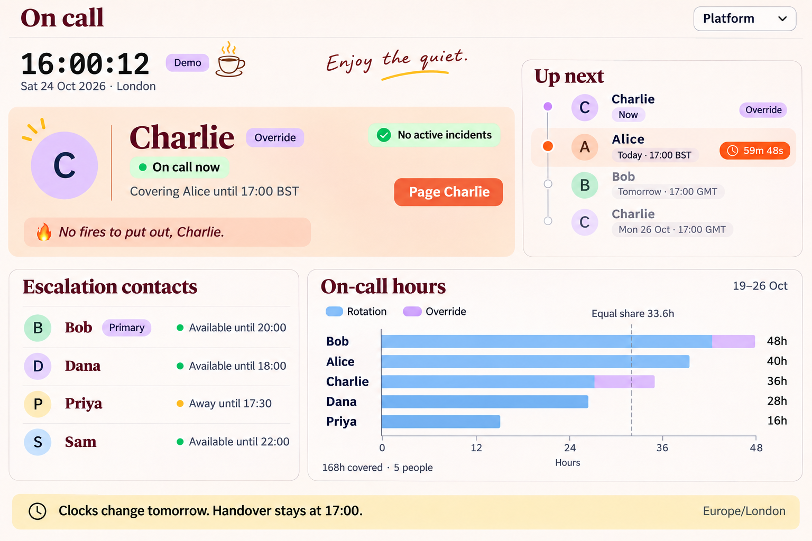
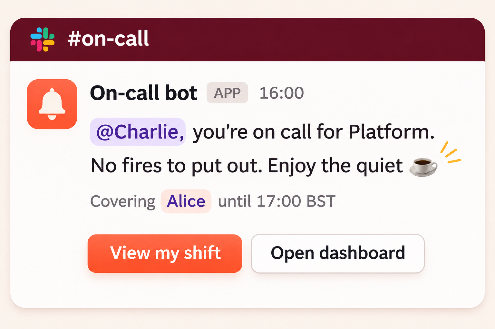
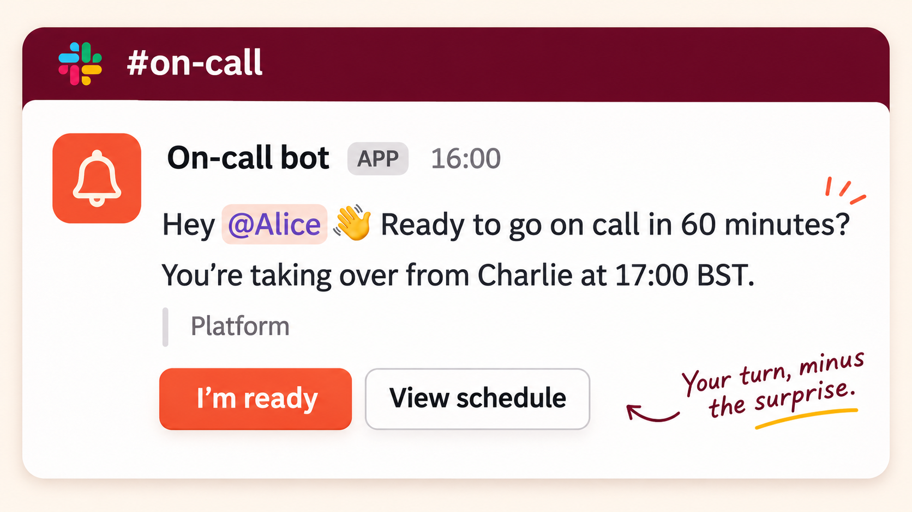
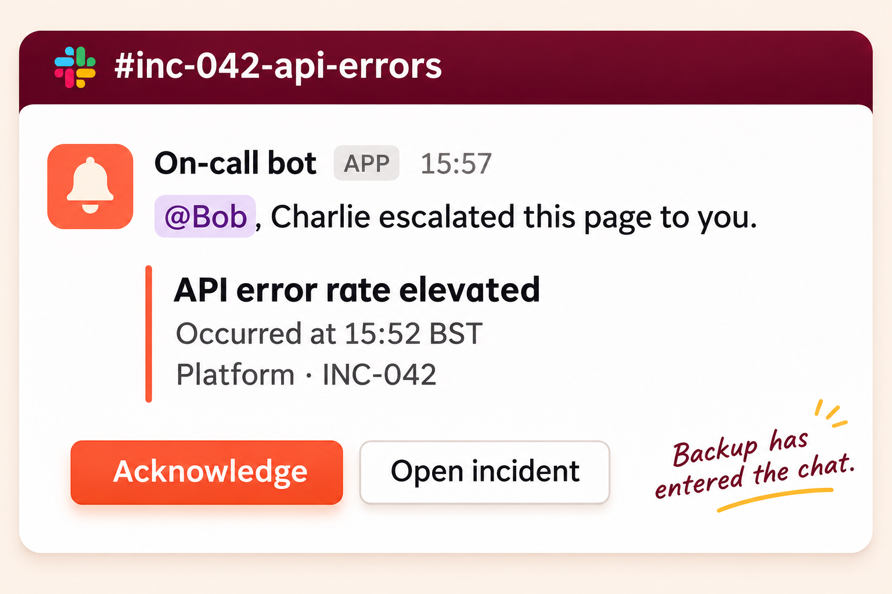

# render-schedule

`render-schedule` renders an on-call schedule from a rotation plus overrides. It is built around one question: **who is on call at time *t*?**

The brief is in [BRIEF.md](BRIEF.md).

## Requirements

- **Python 3.11 or newer.** Check with `python3 --version`.
- **No runtime dependencies.** It uses only the standard library.
- **Tests only:** pytest and Hypothesis (see [Running the tests](#running-the-tests)).

## Usage

### Range mode (the brief)

```console
$ ./render-schedule \
    --schedule=examples/schedule.json \
    --overrides=examples/overrides.json \
    --from='2026-11-06T17:00:00Z' \
    --until='2026-11-20T17:00:00Z'
[
  {
    "user": "alice",
    "start_at": "2026-11-06T17:00:00Z",
    "end_at": "2026-11-09T17:00:00Z"
  },
  {
    "user": "charlie",
    "start_at": "2026-11-09T17:00:00Z",
    "end_at": "2026-11-09T22:00:00Z"
  },
  {
    "user": "alice",
    "start_at": "2026-11-09T22:00:00Z",
    "end_at": "2026-11-13T17:00:00Z"
  },
  {
    "user": "bob",
    "start_at": "2026-11-13T17:00:00Z",
    "end_at": "2026-11-20T17:00:00Z"
  }
]
```

### Point mode: "who do I page right now?"

```console
$ ./render-schedule \
    --schedule=examples/schedule.json \
    --overrides=examples/overrides.json \
    --at='2026-11-09T18:00:00Z'
{
  "at": "2026-11-09T18:00:00Z",
  "user": "charlie",
  "source": "override",
  "next": {
    "user": "alice",
    "source": "rotation",
    "start_at": "2026-11-09T22:00:00Z"
  }
}
```

- **`user` and `source`:** who is on call, and whether that comes from an override or the normal rotation.
- **`next`:** the next time a *different* person takes over.
  - `null` if that never happens, for example in a one-person rotation.
  - Before the schedule starts, `user` is `null` and `next` is the first person on call.

### Flags and exit codes

- `--overrides` is optional.
- `--at` cannot be combined with `--from`/`--until`.
- Run `./render-schedule --help` for the full list.

If the script isn't executable (some ZIP tools drop the permission), run `python3 render-schedule ...` instead.

| Exit code | Meaning |
|---|---|
| `0` | Success. The JSON is printed to stdout. |
| `1` | Invalid input: a missing or non-UTF-8 file, bad JSON, a bad timestamp, overlapping overrides, `--from` not before `--until`, or dates beyond the year 9999. An `error: ...` message is printed to stderr. |
| `2` | Missing, unknown or conflicting flags. The usage message is printed. |

## Running the tests

```console
$ python3 -m venv .venv
$ source .venv/bin/activate          # Windows: .venv\Scripts\activate
$ pip install -r requirements-dev.txt
$ pytest
```

| File | What it covers |
|---|---|
| `tests/test_core.py` | Each core function on its own, the brief's example as a golden test, and the edge cases |
| `tests/test_parsing.py` | Timestamp handling and every validation error |
| `tests/test_cli.py` | Runs the real executable. Checks the brief's output matches byte for byte, plus `--at`, exit codes and error messages. |
| `tests/test_properties.py` | Hypothesis generates hundreds of random schedules. The output is compared hour by hour against a deliberately naive "oracle" that shares no code with the solution. |

## How it works

All the logic is in [`scheduler/core.py`](scheduler/core.py). Every function in it is pure (no I/O).

```
on_call_at(t)                 ← the single source of truth
   ├── render(from, until)    = change points → on_call_at(start of each gap) → merge
   └── next_handover(t)       = first later change point where the person differs
```

1. **`on_call_at(t)`** returns the override covering `t` if there is one. Otherwise it uses the rotation: `users[((t - start) // interval) % len(users)]`.
2. **`render`**:
   - The on-call person can only change at a handover or where an override starts or ends.
   - It collects those "change points" inside `[from, until)` and asks `on_call_at` once per gap between them.
   - It joins back-to-back entries for the same person.
   - The tricky cases need no special code: an override that crosses a handover, a window starting mid-shift, or an override poking out of the window. They are all just more change points. Truncation happens automatically, because no point outside the window is ever created.
3. **`next_handover(t)`** walks forward through the change points after `t` until the person changes. It produces them lazily, using `heapq.merge`, so it stops at the first change without building the rest.
   - Once every override is over, the rotation repeats every `len(users) × interval`.
   - So if nobody new appears within one full cycle after that, nobody ever will. That keeps the search finite.

All time ranges are **half-open, `[start, end)`**. At a handover the incoming person is on call, so back-to-back entries never overlap.

### Design decisions

| Situation | Decision | Reason |
|---|---|---|
| Overlapping overrides | Rejected (exit 1) | Otherwise who is on call would depend on the order of the file. |
| `handover_interval_days` | Positive whole number only | A fractional interval would shift the handover time of day from one shift to the next. |
| Same-person neighbours | Merged, including across handovers | Someone on call without a break is shown as one stretch. |
| Before `handover_start_at` | Nobody is on call | That span is omitted from range output, and `--at` reports `user: null`. |
| Timestamps | Any timezone offset is accepted. Everything is computed and printed in UTC (`...Z`). | Matches the brief exactly and avoids daylight-saving bugs. |
| Fractional seconds | Rejected | Output is in whole seconds, so accepting fractions would print entries that look zero-length or overlapping. |

### Cost

`render` costs roughly O(change points × overrides). For the brief's sizes (a few weeks, fewer than 100 overrides) that is negligible. Overrides are stored sorted, so a binary search would make each lookup O(log n) if it were ever needed.

## Project layout

```
render-schedule        executable entry point (Python version check → scheduler.cli.main)
scheduler/
  models.py            Schedule, Override, Entry, OnCall, Handover dataclasses
  parsing.py           JSON + timestamp parsing, validation, output formatting
  core.py              the scheduling logic (pure functions)
  cli.py               flags, the two modes, error messages, exit codes
tests/                 unit, edge-case, end-to-end and property-based tests
examples/              the brief's schedule and override
docs/mockups/          concept designs for future features (not implemented)
```

Dependencies run one way: `cli → core / parsing → models`. The core never touches files or JSON, so it could sit behind an HTTP API or a paging service unchanged.

## What I'd build next

The features I'd build next all extend the same core function, `on_call_at(t)`.

- **Paging integration.** When an alert fires, call `on_call_at(now)` and notify that person directly.
- **Handover reminders.** `next_handover` already knows who takes over and when, so it can send messages like "you're on call in an hour".
- **Escalation.** If a page isn't acknowledged within a few minutes, page a backup. That could be the next person in the rotation or a separate escalation list.
- **Fairness report.** Add up each person's hours from the rendered schedule. That shows whether on-call load is shared evenly, and how much of it comes from covering overrides.
- **Timezone-aware handovers.** Store the handover as a local time plus a timezone, for example "17:00 Europe/London", instead of fixed UTC days. That fixes the current limitation where handovers drift by an hour when the clocks change.

None of these are built yet. Together they would turn the scheduler into something closer to a full on-call product, like the dashboard I show in the video.

### Mock-ups

These are concept designs only. Nothing in them is implemented.

**On-call dashboard.** This view brings the features together:
- "Who's on call now" comes from `on_call_at(now)`.
- "Up next", with its countdown, comes from `next_handover`.
- The escalation contacts are listed alongside.
- An on-call hours chart works as the fairness report.
- A banner shows a timezone-aware handover.



**Paging.** The on-call person is told they're on call, and why. Here Charlie is covering Alice through an override.



**Handover reminder.** An hour before Alice's shift, she gets a heads-up built from `next_handover`.



**Escalation.** If a page isn't acknowledged, or the on-call person needs help, it goes to a backup. Here Charlie escalates the page to Bob.


